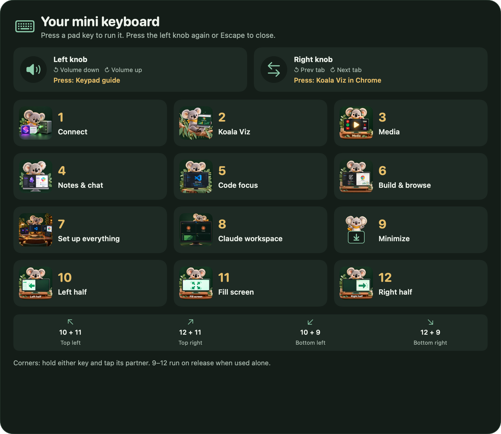
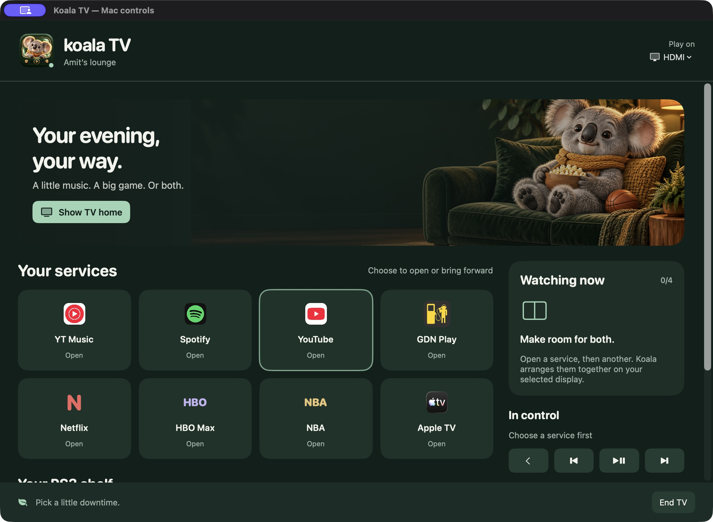

<div align="center">


# Koala Controls

**Your desk. Your couch. One very helpful koala.**

A native macOS control suite: a mini keyboard for your desk, an iPhone remote in your pocket, and a living-room home for your media.

[Install](docs/INSTALL.md) · [Mini Keyboard](docs/MINI-KEYBOARD.md) · [Koala TV](docs/KOALA-TV.md) · [iPhone remote](docs/PHONE-REMOTE.md) · [Screenshots](docs/GALLERY.md)

  

</div>



## Three ways in. The same actions underneath.

| Mini Keyboard | Koala Remote | Koala TV |
| --- | --- | --- |
| Map a USB macro pad, arrange your workspace, move windows and hold a shortcut guide. | Turn an old iPhone into a shortcut pad, trackpad and media remote. | Use a Mac as a playful TV launcher, with playback controls on your phone. |
| [Explore the keyboard →](docs/MINI-KEYBOARD.md) | [Pair your phone →](docs/PHONE-REMOTE.md) | [Explore the TV →](docs/KOALA-TV.md) |

**One repository is intentional.** Both Mac apps use one signed host, one action engine, and one phone pairing system. `Koala TV.app` is a small launcher; `Mini Keyboard.app` runs the suite. Splitting the code would mean duplicated permissions, networking and fixes. You can use TV mode without buying a macro pad.

## Mini Keyboard

- Learn your pad's inputs and assign actions using macOS's device-specific remapping. No extra driver is required in native mode.
- Keep the same workspace actions on your MacBook with **Command + Option** shortcuts.
- Show the illustrated shortcut map by holding Command + Option, or pushing the guide knob.
- Move windows left, right, fill, minimize, or combine keys to snap into four corners.
- Arrange Obsidian/Slack, VS Code, or Zed/Chrome on the display under the mouse. When mobile, reuse native Full Screen / Split View Spaces.
- Prefer a connected Sidecar iPad for media. Add another service to share the display.
- Reuse a VS Code SSH workspace with two Claude/tmux chats, nvitop and a free shell using the included extension.
- Enjoy little koala reactions, rare animation variants, basketball shots, local XP and function mastery.

## Koala TV



- A TV-friendly home for **YouTube Music, Spotify, YouTube, GDN Play, Netflix, HBO Max, NBA League Pass and Apple TV**.
- Discover recognized open media, then resume its existing window or tab.
- Share a display between up to four services, or focus one.
- Enter actual fullscreen video from the TV toolbar, Mac controls or iPhone.
- Remember your chosen TV and optionally start when it reconnects. Optionally blank the MacBook with a reversible cover.
- Browse your existing RPCS3 library and return to an already running game. Emulator setup and games are yours to provide.
- Control audio output, volume and supported paired Bluetooth headphones. Experimental local captions are opt-in and may lag speech.

Streaming subscriptions, service apps, browsers and RPCS3 are not bundled. Koala organizes their windows; it is not a replacement browser, streaming subscription, or macOS.

## Get running

**Apple Silicon is the tested path.** Core controls target macOS 13+; iPhone pairing requires macOS 15+; live captions require macOS 26+. Building needs a recent Xcode toolchain with a macOS 26+ SDK, plus Python 3. See the [installation guide](docs/INSTALL.md) for permissions and the new-Mac checklist.

```sh
git clone https://github.com/amit154154/koala-controls.git
cd koala-controls
./build.sh --build-only
```

This builds both apps without touching an installed copy. Quit Mini Keyboard normally before installing:

```sh
python3 Tools/install.py
open "/Applications/Mini Keyboard.app"
```

Or use the **Apple Silicon app bundle** from [Releases](https://github.com/amit154154/koala-controls/releases). The public builds are ad-hoc signed and not notarized; source builds are the reproducible development path. A stable signing identity is recommended for repeated updates so macOS permissions can persist.

## Personal by design, portable by default

This began as my own desk-and-couch project. The public edition includes a complete starter action map but no learned hardware keys, account sessions, paired phones, private TV identifiers or personal configuration files. Connect and localhost visualization actions are optional integrations you configure yourself. Your learned inputs and assignments stay local.

The public sound pack is synthesized from scratch by [`Tools/generate_sounds.py`](Tools/generate_sounds.py). Commercial game sound files are not distributed. Legacy filenames are retained internally for compatibility.

## Under the hood

Swift · AppKit · SwiftUI · Accessibility · IOHID per-device mapping · Carbon hotkeys · Network.framework TLS · vanilla JavaScript PWA · a dependency-free VS Code extension.

- [Architecture and development](docs/DEVELOPMENT.md)
- [Privacy and permissions](docs/PRIVACY.md)
- [Troubleshooting](docs/TROUBLESHOOTING.md)
- [Contributing](CONTRIBUTING.md) · [Security](SECURITY.md) · [Third-party notices](THIRD_PARTY_NOTICES.md)

Made by [Amit Israeli](https://amit154154.github.io/). Original code is [MIT licensed](LICENSE).
