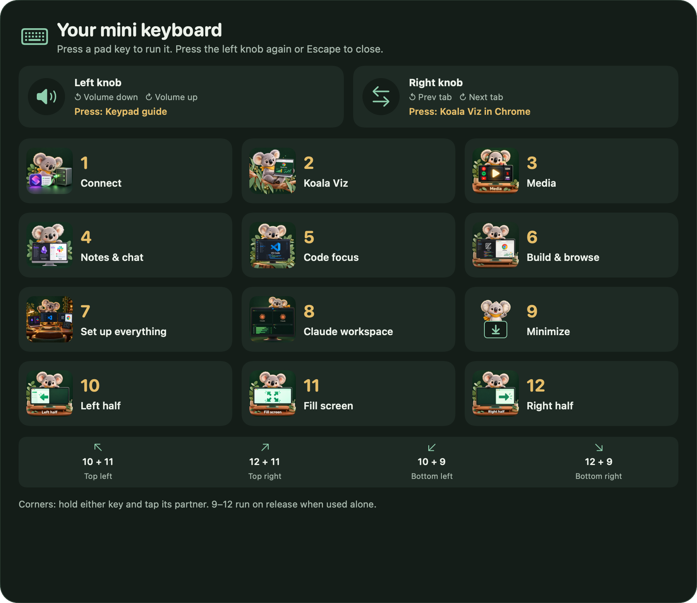
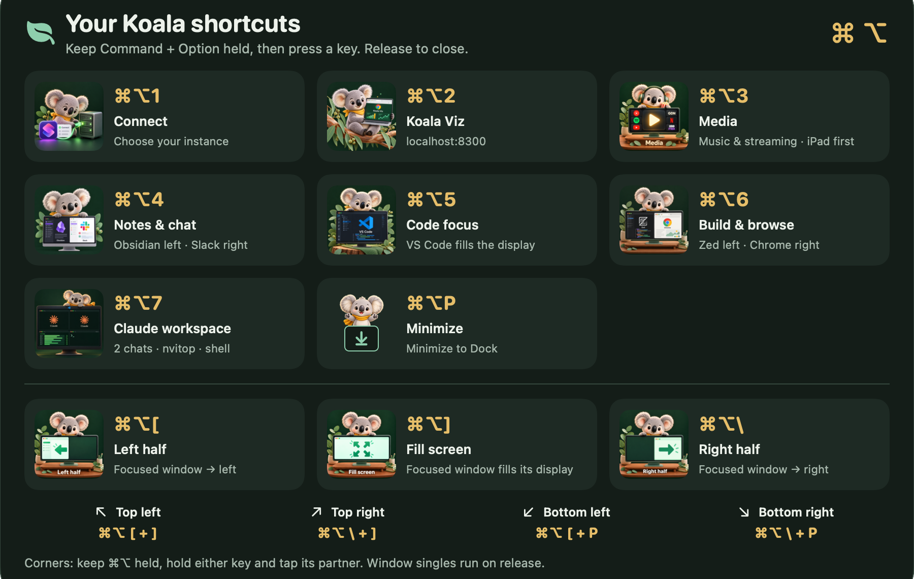
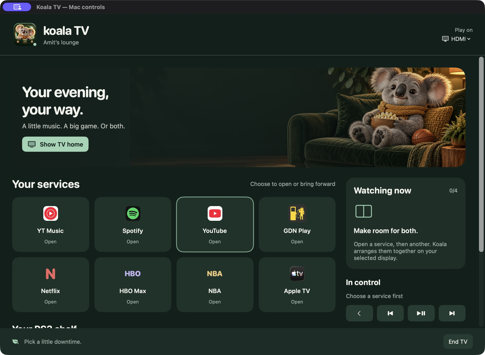
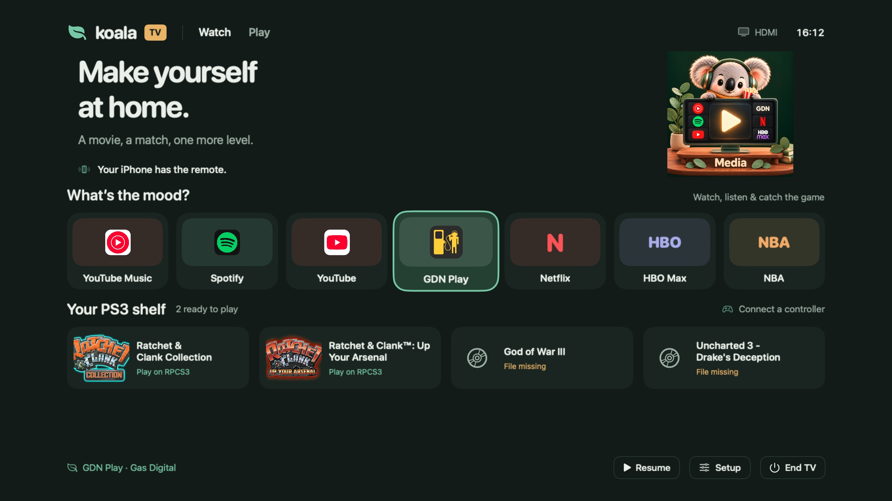
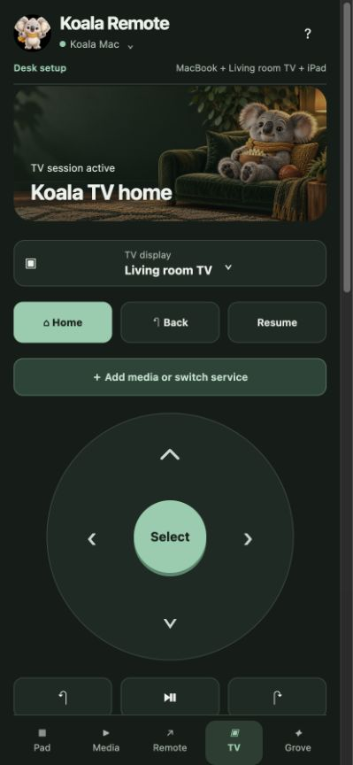

# A look around

[← Overview](../README.md)

## Mini Keyboard: the illustrated shortcut guide

Rendered from the public edition's real SwiftUI guide and starter actions. Hardware inputs still need learning on your pad.

## MacBook: hold Command + Option

## Koala TV: desktop companion

## Koala TV: living-room home

## iPhone: couch controls

TV and phone images show the existing product UI from development; some depict earlier layouts, and the current version also includes fullscreen and audio controls. No paired-phone tokens, setup codes, private network addresses or terminal contents are shown.
