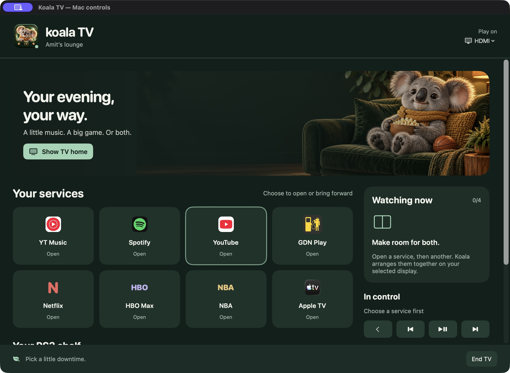

# Koala TV

**A little music. A big game. Or both.**

[← Overview](../README.md) · [Install](INSTALL.md) · [iPhone remote](PHONE-REMOTE.md)

Koala TV turns a Mac connected to a TV into a media launch-and-control space. The desktop UI works with the MacBook open; the phone gives you a couch remote when the lid is closed. Closed-lid operation still depends on macOS requirements, power and your display setup.

## Watch, listen, resume

Choose YouTube Music, Spotify, YouTube, GDN Play, Netflix, HBO Max, NBA League Pass or Apple TV. Native apps/PWAs are used where available; browser services use Chrome. Sign into the services normally. Koala does not handle passwords, bypass subscriptions or redistribute streams.

**Continue watching** discovers supported open media windows and Chrome tabs. Resume returns to existing playback instead of intentionally reloading it. Discovery is limited to recognized services; refresh after opening something new.

Add another service to share the selected screen. Up to four services can use a split/grid layout; Focus one expands a service within the managed layout. Choose a session item to direct controls to it. Hiding a window does not guarantee that its audio stops.

## Actual fullscreen

Use **Full screen** on the watch toolbar, Mac controls, or iPhone TV tab. The focused player is positioned on the chosen TV first, then enters fullscreen. The navigation rail hides during playback. Use **Exit full screen**, **Home**, or the player's normal Escape behavior to return.

Fullscreen support depends on the service/player exposing compatible controls. GDN has a dedicated path that focuses its actual video fullscreen button and activates it through keyboard input. It preserves playback. Koala protects fullscreen players from automatic shared-layout resizing.

## Remember this TV

Choose your external TV under Setup, then **Use this display for automatic TV**. Enable automatic start and optionally blank the Mac screen. The public build ships with both behaviors **off** and no saved display identity.

The Mac blackout is a reversible cover, not a brightness or power change. Click the black Mac display or use **Show Mac screen** on the phone to recover. Ending TV or disconnecting the TV removes it. Manual End TV suppresses automatic reopening until reconnect.

## Sound and headphones

Audio controls select supported system outputs, adjust exposed volume/mute, and connect supported already paired Bluetooth headphones/AirPods. Pair new devices in macOS Bluetooth settings first. HDMI and some Bluetooth outputs own their volume and may not expose a software slider.

Experimental live captions use local, opt-in transcription of selected playback audio. They need macOS 26+ and may have model-download or timing limitations. They are not a promised real-time subtitle replacement.

## Your existing games

Koala reads the existing RPCS3 library for a game shelf and can launch an explicitly selected game through RPCS3 or return to an open session. It does not configure controllers, rewrite emulator settings or include firmware, games or ROMs. Set up RPCS3 and legally obtained content separately.

## Why one repository?

The TV home, desktop companion, iPhone controls and keyboard all share the host's actions and permissions. `Koala TV.app` is a tiny launcher for the same running host. Keeping them together makes installation and updates simpler.

More: [screenshots](GALLERY.md) · [troubleshooting](TROUBLESHOOTING.md).
