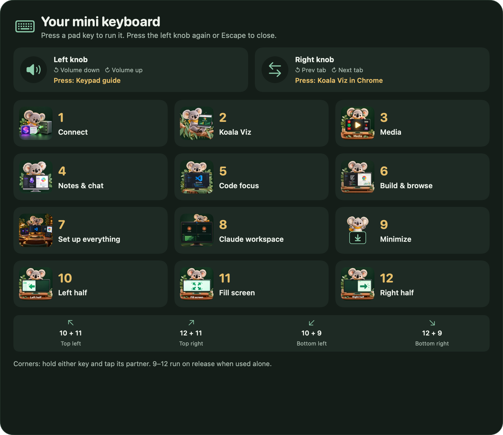

# Mini Keyboard

[← Overview](../README.md) · [Install](INSTALL.md) · [iPhone](PHONE-REMOTE.md)



## Starter layout

The starter actions are ready to customize. Hardware sources are learned on your own device; this is not a firmware flash.

| Pad | Action | Laptop (Command + Option) |
| --- | --- | --- |
| 1 | Optional Connect integration | 1 |
| 2 | Koala Viz in Chrome at localhost:8300 | 2 |
| 3 | Media chooser, preferring connected iPad | 3 |
| 4 | Obsidian left / Slack right | 4 |
| 5 | VS Code | 5 |
| 6 | Zed left / Chrome right | 6 |
| 7 | Set up the whole desk | — |
| 8 | Claude/tmux workspace in active VS Code | **7** |
| 9 | Minimize focused window | P |
| 10 | Left half | [ |
| 11 | Fill display | ] |
| 12 | Right half | Backslash |

Hold Command + Option alone for the illustrated laptop guide. The physical guide knob shows the keypad layout. Left rotation controls volume; right rotation changes tabs; the right press reuses Koala Viz when Chrome is active. Device/firmware input differences require learning.

### Four corners

| Position | Physical chord | Laptop chord while holding Command + Option |
| --- | --- | --- |
| Top left | 10 + 11 | [ + ] |
| Top right | 12 + 11 | Backslash + ] |
| Bottom left | 10 + 9 | [ + P |
| Bottom right | 12 + 9 | Backslash + P |

Either order works. A matched pair consumes both singles. Keys 9–12 execute on release when used alone. Custom remapped actions retain their own behavior. The phone also has explicit corner buttons.

## Your screens

At a desk, workspace actions use the monitor under the mouse. When mobile, Code uses a reusable native Full Screen Space; the app pairs use reusable Split View Spaces. Media prefers Sidecar iPad, then the pointer's display. Multiple media services share the destination.

Set up everything arranges Notes/Slack on the MacBook, Code on the middle external and Zed/Chrome on the right external. Fewer displays have smaller recipes. With only the MacBook, it opens Obsidian. A connected iPad gets a media chooser, not automatically selected content.

## Optional personal integrations

### Connect

Create an Apple Shortcut that connects to your own workstation. Copy `Examples/connect.json` to `~/Library/Application Support/Mini Keyboard/connect.json` and set `config.shortcut` to that Shortcut's name. No SSH credentials or instance endpoints are bundled. If you do not need Connect, assign button 1 to another action in Setup.

### Koala Viz

The supplied action reuses a Chrome tab for `http://localhost:8300/`. It does not start a visualization server or SSH port forwarding. Run your own service/tunnel there, change `Resources/KoalaChrome.applescript` for a different project, or assign another open-URL action.

### VS Code Claude workspace

```sh
python3 VSCodeExtension/package-vsix.py build/koala-workspace.vsix
code --install-extension build/koala-workspace.vsix
```

In your active trusted SSH workspace, install `tmux`, `claude`, and `nvitop` remotely. Run **Koala: Set Up Claude Workspace**, physical 8 or Command–Option–7. Existing `claude_Tleft`/`claude_Tright` sessions attach; missing sessions are created with ordinary Claude. The helper preserves existing chats and does not send prompts or change Claude permissions. See [the extension README](../VSCodeExtension/README.md).

## Feedback and progress

Shortcuts can play a shuffled original sound, show a small koala reaction, and earn local XP. Each function has mastery levels and unlockable flourishes; rare scenes vary the routine. Movement uses its own sound bag, with separate sounds reserved for function/player level-ups. Mute, volume and reduced-motion preferences apply.

The local journal records invoked shortcut, time, source, connection snapshot and result. It does not record ordinary typing or credentials. See [privacy](PRIVACY.md).
