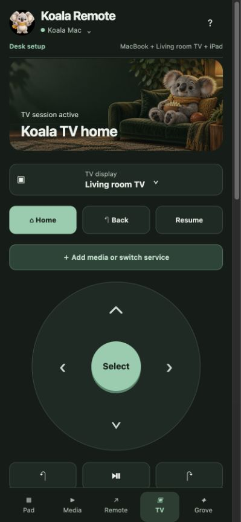

# Koala Remote on iPhone

[← Overview](../README.md) · [Install](INSTALL.md) · [TV](KOALA-TV.md)

An old iPhone can become a shortcut pad, media selector and trackpad for your Mac. There is no App Store install: Safari runs the local web app, which you can add to the Home Screen. Pairing requires macOS 15+; both devices must be on the same local network, with the Mac awake and Mini Keyboard running. A USB cable alone is not the network connection.

## Pair once

1. Open **Phone remote** in Mini Keyboard and enable the local server.
2. Use **AirDrop setup profile…** to send this Mac's trust profile to the phone.
3. On iPhone, install it in **Settings → General → VPN & Device Management**.
4. Enable the Koala Remote certificate under **General → About → Certificate Trust Settings**. This trusts this Mac's local HTTPS certificate; it is not device management. Only install a profile you generated on your own Mac.
5. Open the Mac UI's current HTTPS/QR URL in Safari. Port is **9472**; use the shown hostname, not an old example from another Mac.
6. Enter the short-lived pairing code, compare the verification code, then approve the phone on the Mac.
7. Use Safari **Share → Add to Home Screen**.

## What is on the phone?

- **Pad:** the same 12 actions, long-press help, corner combinations and explicit corner buttons.
- **Media:** service selection, display targeting and shared media layouts.
- **Remote:** trackpad, clicks, two-finger scrolling, text input, volume, tabs and Previous/Next Space.
- **TV:** Home/Back/Resume, service/session selection, transport, fullscreen, audio controls and Show Mac screen.
- **Grove:** local progress, function mastery and recent activity.

Tap feedback uses an original bundled sound pack. Safari requires a user gesture before audio and may suspend a background web app. Wake lock also depends on browser support. Refresh/reopen after installing an updated host to load the latest interface.

## Connection and privacy

Commands travel to your Mac over local TLS. A trusted certificate does not automatically authorize control: pairing still requires Mac approval. Revoke a phone from the Mac UI. Expired, invalid and disconnected actions are not blindly replayed. There are no arbitrary shell, file or clipboard API endpoints. Remote text insertion blocks password fields.

Keep port 9472 on your trusted local network; do not port-forward it to the internet. Pair each new Mac normally rather than sharing its private keys. See [privacy and security](PRIVACY.md).
